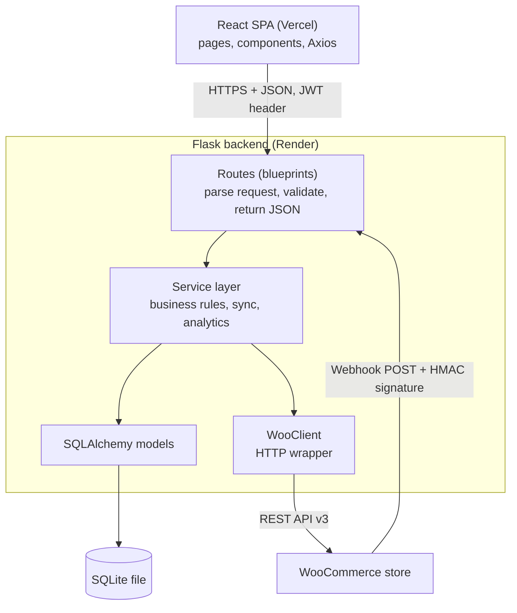
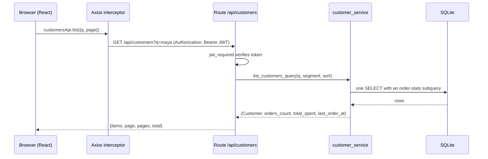
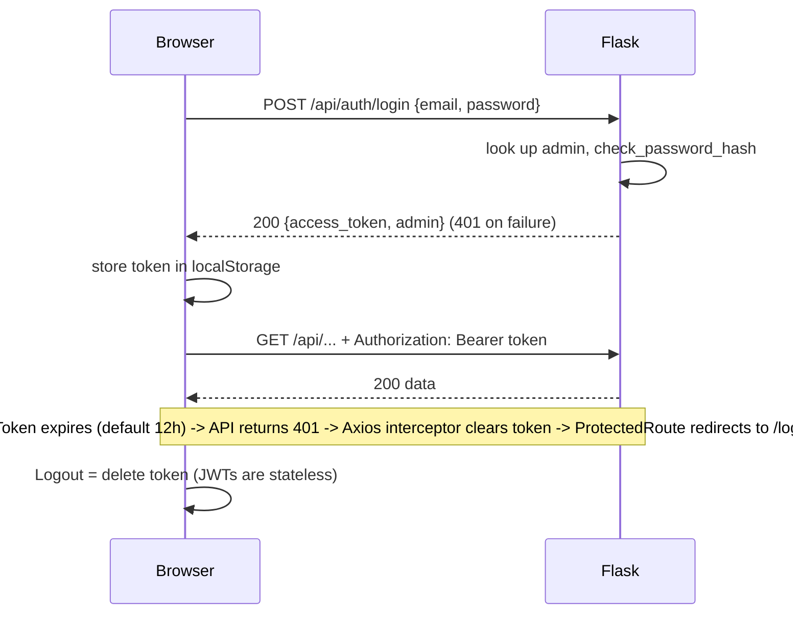
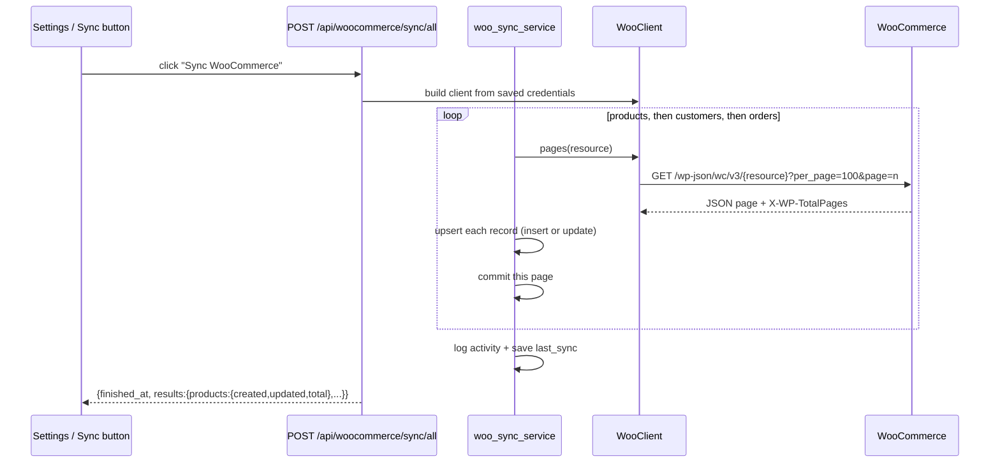
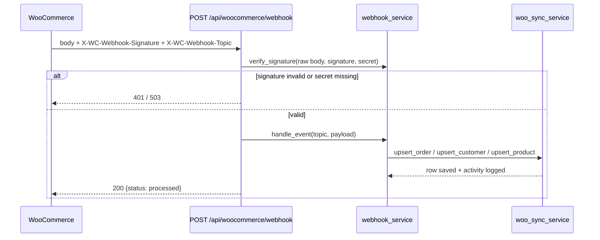

# 2. Architecture

## Layered architecture
Each layer talks only to the one below it. This keeps HTTP concerns out of business logic and makes each layer testable.

| Layer | Folder | Responsibility | Must NOT |
|-------|--------|----------------|----------|
| Routes | `app/routes` | Read request, check input, call a service, shape the response | Contain business rules or SQL |
| Services | `app/services` | Business rules: sync, segments, analytics, webhook handling | Read Flask `request` objects; they receive plain values from routes |
| Models | `app/models` | Table definitions, relationships, small derived properties | Call external APIs |
| WooClient | `app/services/woo_client.py` | All HTTP to WooCommerce | Touch the database |

Dependencies point downward only: routes → services → models/WooClient. Because `woo_sync_service` receives a *client object*, tests pass a `FakeWooClient` and never touch the network.

## Request flow (a normal page load)

## Authentication flow

**Trade-off:** `localStorage` is simple but readable by any script running on the page (XSS risk). For production consider an httpOnly cookie plus CSRF protection. **Logout** only removes the token client-side; a stolen token stays valid until it expires. A server-side blocklist is listed in the roadmap.

## WooCommerce sync flow (manual button)

Order matters: products first (so order lines can link to products), customers second, orders last.

## Webhook flow (real time)

Key points:
1. **The endpoint is public** (WooCommerce cannot send a JWT), so the HMAC signature is the only protection. We verify against the *raw bytes* of the body, using `hmac.compare_digest`.
2. **Idempotent.** WooCommerce may deliver the same event twice or out of order. Upserts make that harmless.
3. **Always answer fast.** WooCommerce disables a webhook after repeated failed deliveries, so we return 500 only on genuine processing errors.
4. `*.deleted` topics are ignored on purpose: a CRM should keep history.
5. The "ping" WooCommerce sends when you save a webhook is form-encoded; we answer `pong`.

## Where did AI go?
Removed from this build as requested. The service layer is the natural place to add it later (`ai_service.py` reading from `customer_service`), with no changes to existing code.
