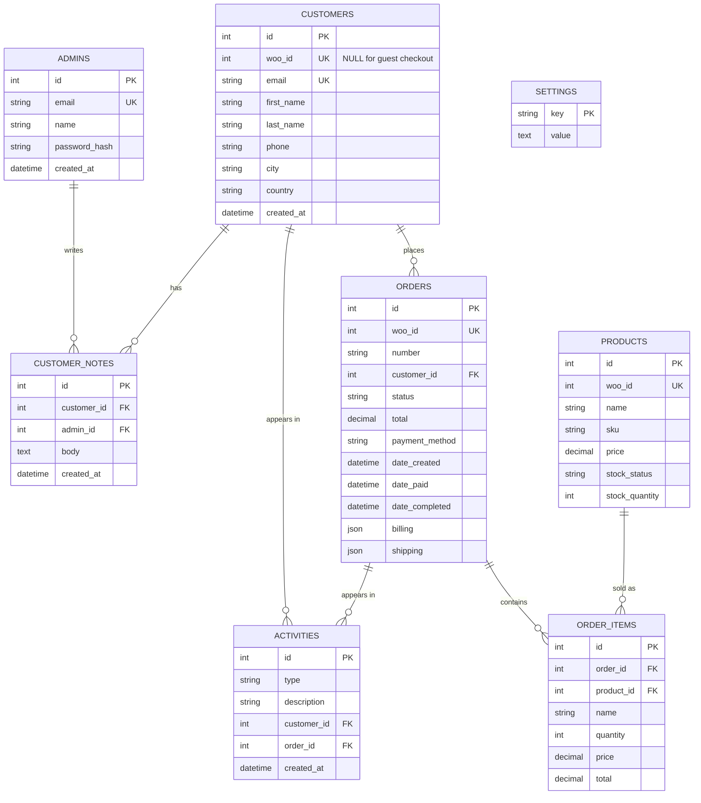

# 3. Database design

SQLite, accessed through SQLAlchemy. Tables are created automatically on startup (`db.create_all()`).

## ER diagram

## Why each table exists
| Table | Purpose | Requested? |
|-------|---------|-----------|
| `admins` | CRM users who log in. Separate from WooCommerce users. | Yes |
| `customers` | Mirror of shoppers. `woo_id` links to WooCommerce; it is NULL for guest checkouts so every order still belongs to someone. `email` is unique and lower-cased, which is how guest orders and later registrations are merged. | Yes |
| `orders` | Mirror of orders, including billing/shipping snapshots (JSON) because an address on an old order must not change when the customer edits their profile. | Yes |
| `order_items` | **Added.** An order has many lines. Storing them as a JSON blob would make "what sold best" impossible to query; this is the normalised design (3NF). | Added for normalisation |
| `products` | Catalogue mirror; lets order lines link to products and powers the Products page. | Yes |
| `customer_notes` | Private admin notes. Kept apart from `activities` because notes are editable user content, activities are an append-only log. | Yes |
| `activities` | Append-only event log driving "Recent activity" and the customer timeline. | Yes |
| `settings` | **Added.** Key/value store for WooCommerce credentials and last-sync info so the owner can configure the app from the UI. | Added |

## Design decisions
- **Own primary key plus `woo_id`.** We never use WooCommerce's ID as our key; it keeps the door open to other sources and lets guest customers exist.
- **Derived, not stored:** `payment_status`, `shipping_status`, customer `orders_count`, `total_spent`, `segment`. Stored copies go stale; derived values are always right.
- **Money** uses `Numeric(12,2)` (never float) and is converted to float only at the JSON boundary. SQLite stores it loosely; PostgreSQL enforces it.
- **Timestamps** are naive UTC. The frontend converts to local time.
- **Indexes** on every foreign key, `woo_id`, `email`, `status`, and date columns used for sorting.

## Business definitions (single source of truth: `models/order.py`)
| Term | Definition |
|------|------------|
| Revenue | Sum of `total` for orders with status `completed` or `processing` |
| Pending orders | Status `pending`, `on-hold` or `processing` (needs attention) |
| Payment status | `refunded`/`failed`/`cancelled` follow the order status; otherwise `paid` if `date_paid` is set or status is `completed`, else `pending` |
| Shipping status | WooCommerce has no shipping field, so: pending → awaiting_payment, on-hold → on_hold, processing → to_ship, completed → delivered, others → not_applicable |
| Segment | `vip` spent ≥ `VIP_THRESHOLD` (default 500); `returning` 2+ orders; `new` exactly 1 order; `prospect` 0 orders |
