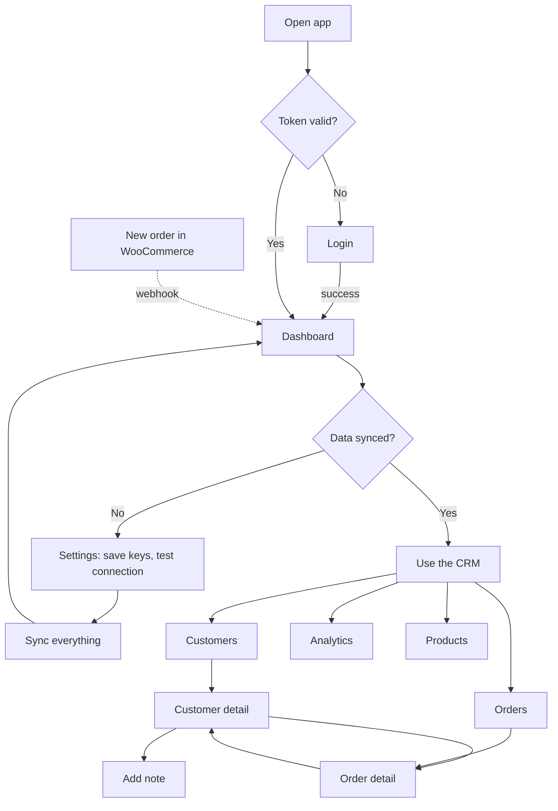
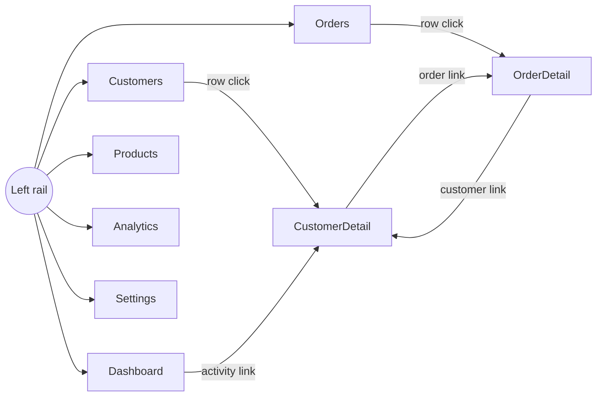

# 5. UI pages and user flow

## Page list
| Route | Page | What it contains |
|-------|------|------------------|
| `/login` | Login | Email and password form, error message. Redirects to the page you tried to open. |
| `/` | Dashboard | Stat strip (customers, orders, revenue, pending orders, average order), 12-month revenue chart, recent activity feed. First-run empty state guides you to connect the store. |
| `/customers` | Customers | Search box, segment filter, sort, table (customer, location, segment, orders, spend, joined), pagination. |
| `/customers/:id` | Customer detail | Lifetime stats, contact details, recent orders, private notes (add/delete), activity timeline. |
| `/orders` | Orders | Search, status filter, table with order status, payment status, shipping status, total. |
| `/orders/:id` | Order detail | Line items, totals, payment and shipping panel, customer link, billing and shipping addresses. |
| `/products` | Products | Searchable catalogue with image, SKU, categories, stock, price. |
| `/analytics` | Analytics | Revenue by month, orders per month, customer growth, top customers (chart + table). |
| `/settings` | Settings | Store URL and API keys, test connection, manual sync (all or per resource), webhook URL and setup steps. |
| `*` | Not found | Friendly 404 with link home. |

Always visible (inside the layout): left navigation rail, user name and log out, **Sync WooCommerce** button in the top bar.

## User flow

## Navigation map

## Design notes
- A dense, table-first layout: this is a tool people work in, not a landing page.
- One accent colour (teal) for actions; amber, sky and rose are reserved for status meaning.
- Motion is limited to a short page fade, the sync popover and note add/remove, and turns off when the OS requests reduced motion.
- Every list page has loading, empty and error states; every input has a label; focus rings are visible.
